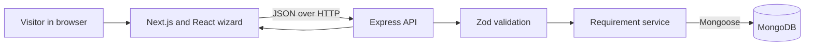

# GoPratle Requirement Posting — Owner’s Guide

This guide explains what the application does, how its parts fit together, how to run and test it, and what to consider before operating it with real users.

## At a glance

GoPratle is a full-stack event requirement posting demo. A visitor fills out a four-step form to describe an event and request an event planner, performer, or event crew. The browser validates fields as the visitor moves through the form; the API validates the submitted data again and stores it in MongoDB. After a successful save, the UI shows the new requirement’s database ID.

The system has three main parts:

1. **Next.js frontend** — renders the wizard, collects form data, and calls the API.
2. **Express API** — validates requests, applies middleware, and implements the HTTP endpoints.
3. **MongoDB database** — stores requirements through Mongoose.

The repository includes Docker Compose configuration for a local MongoDB server, Vitest suites for the frontend and API, and deployment notes for a hosted frontend and backend. No deployment or live database connection is configured by the repository itself.

## Architecture and request flow



When a visitor submits a requirement:

1. The wizard gathers event basics, category-specific details, optional context, and a final review.
2. React Hook Form manages field values and errors. Frontend Zod schemas validate each step and the complete payload.
3. The frontend API client sends a JSON `POST /api/requirements` request to `NEXT_PUBLIC_API_URL` (default `http://localhost:4000`). It prevents duplicate in-flight submissions in the current browser runtime.
4. Express applies security headers, CORS, request logging, JSON parsing with a 32 KB limit, and the write rate limiter on the POST route.
5. The backend Zod schema validates the payload and checks that the selected category matches the shape of `details`.
6. The service creates a Mongoose `Requirement` document. MongoDB timestamps supply `createdAt` and `updatedAt`.
7. The API returns the ID, category, status, and creation time. The UI only displays its success state after receiving that response.

The frontend schema improves the form experience, but it is not a security boundary. The backend schema is authoritative because API callers can bypass the UI.

## Repository map

| Path | Purpose |
|---|---|
| `frontend/src/app/` | Next.js app entry point, page metadata, and global styles |
| `frontend/src/components/RequirementWizard.tsx` | Four-step form, category switching, review, and success state |
| `frontend/src/components/Field.tsx` | Reusable labeled inputs, select, textarea, and error display |
| `frontend/src/schemas/requirement.ts` | Browser-side Zod schemas and step validation |
| `frontend/src/types/requirement.ts` | TypeScript types for categories and API payloads |
| `frontend/src/lib/api.ts` | API URL, JSON parsing, and submission request |
| `frontend/src/components/RequirementWizard.test.tsx` | UI component tests with a mocked API |
| `backend/src/server.ts` | Loads environment, connects to MongoDB, starts HTTP server, handles shutdown signals |
| `backend/src/app.ts` | Express app and middleware registration |
| `backend/src/routes/requirementRoutes.ts` | API route declarations and POST rate limiter |
| `backend/src/controllers/requirementController.ts` | HTTP request parsing and response status codes |
| `backend/src/validators/requirement.ts` | Authoritative API input validation |
| `backend/src/services/requirementService.ts` | Create, fetch, and list operations |
| `backend/src/models/Requirement.ts` | Mongoose schema, timestamps, and indexes |
| `backend/src/middleware/` | Request logging, not-found response, and centralized error handling |
| `backend/tests/requirements.test.ts` | API tests against an in-memory MongoDB server |
| `docker-compose.yml` | Local MongoDB and optional Mongo Express services |
| `backend/.env.example`, `frontend/.env.example` | Example environment variables; copy these to local `.env` files |

## How the form works

The wizard has four steps:

1. **Event basics:** event name and type, dates, location, optional venue, and category.
2. **Requirements:** fields change based on the chosen category.
3. **Additional details:** optional description, special instructions, contact preference, and response deadline.
4. **Review:** a summary with edit links before submitting.

Categories and their specific fields:

| Category | Details collected |
|---|---|
| Planner | Requested services, guest count, planning scope, optional budget range, additional requirements |
| Performer | Performance type, duration, performer count, technical requirements, optional budget range, additional requirements |
| Crew | Crew roles, crew count, working hours, optional budget range, equipment/skills, additional requirements |

Changing category replaces the `details` object with defaults for the new category. Fields from the old category should not be treated as shared fields. `category` is normalized to `planner`, `performer`, or `crew` in storage.

Dates are compared as ISO date strings on the frontend and parsed as dates on the backend. End date must be on or after start date. A response deadline, when supplied, must be on or before the event start date. Budget values cannot be negative, and a maximum budget cannot be less than the minimum.

## Data model

Each MongoDB `Requirement` contains:

- Event name, type, start and end dates, location, and optional venue.
- One category: `planner`, `performer`, or `crew`.
- A category-specific `details` object.
- Optional `additionalDetails` including description, special instructions, a preferred contact method, and a response deadline.
- A fixed `submitted` status.
- Mongoose `createdAt` and `updatedAt` timestamps.

Indexes support category filtering and newest-first listing. The details field is stored as a mixed object; Zod validation, rather than a nested Mongoose schema, enforces category-specific structure.

## API reference

All endpoints return JSON.

### Health check

`GET /api/health`

Returns `200` when the Express app is serving requests. This endpoint does not independently verify that MongoDB is healthy after startup.

### Create a requirement

`POST /api/requirements`

Accepts the event fields, `category`, category-specific `details`, and optional `additionalDetails`. Returns `201` with the saved ID, category, status, and ISO creation timestamp. Invalid input returns `400` with a message and Zod field errors. Request bodies over 32 KB return `413`.

The POST route is rate limited to 10 requests per 15 minutes in normal environments. When `NODE_ENV=test`, the configured limit is 100 per 15 minutes.

### Fetch one requirement

`GET /api/requirements/:id`

Returns `400` for a malformed ID, `404` for a valid ID with no matching document, or `200` with the full stored requirement.

### List requirements

`GET /api/requirements?category=planner&page=1&limit=10`

Category is optional. `page` defaults to 1; `limit` defaults to 10 and must be between 1 and 100. Results are sorted newest first and include `items` plus pagination metadata. This list route removes `additionalDetails.contactMethod` and `additionalDetails.specialInstructions` from returned items.

## Local development

### Prerequisites

- Node.js 20.9 or later and npm.
- Docker Desktop with Docker Compose for the local MongoDB service, or a MongoDB connection string you can use for development.

### Install dependencies

Run these commands from the repository root, in PowerShell or another shell:

```powershell
cd backend
npm install
cd ../frontend
npm install
cd ..
```

### Configure environment

Copy `backend/.env.example` to `backend/.env` and `frontend/.env.example` to `frontend/.env.local` (or `.env`). The examples use:

```text
# Backend
NODE_ENV=development
PORT=4000
MONGODB_URI=mongodb://127.0.0.1:27017/gopratle
CLIENT_URL=http://localhost:3000

# Frontend
NEXT_PUBLIC_API_URL=http://localhost:4000
```

`MONGODB_URI` is required for the backend to start. `CLIENT_URL` controls the browser origin allowed by CORS. `NEXT_PUBLIC_API_URL` is compiled into the frontend and should point to the backend’s public HTTPS origin when deployed. Do not put secrets in `NEXT_PUBLIC_` variables; those values are exposed to browsers.

### Start MongoDB and the applications

From the repository root:

```powershell
docker compose up -d mongodb
```

Then open two terminals:

```powershell
# Terminal 1
cd backend
npm run dev
```

```powershell
# Terminal 2
cd frontend
npm run dev
```

Open `http://localhost:3000`. The API defaults to port `4000` and the local database to port `27017`.

The Compose file also defines Mongo Express on `http://localhost:8081`. It is optional and depends on MongoDB becoming healthy. Its example credentials are for local demonstration only; change them before using that service in any shared environment. Both services bind to loopback in the Compose configuration. The named Docker volume preserves database files when containers are stopped. `docker compose down` stops containers but keeps the volume; `docker compose down -v` removes the volume and its data.

## Tests and quality checks

Run each suite from its application directory after installing dependencies:

```powershell
cd backend
npm test
```

```powershell
cd frontend
npm test
```

Backend tests use `mongodb-memory-server`, so they do not use the local Docker database or `MONGODB_URI`. On the first run, that package may need to download a MongoDB binary; the Vitest config allows longer setup time for this. The frontend tests use Vitest, jsdom, and Testing Library, and mock the network client.

The existing tests cover core API validation and persistence, category-aware wizard behavior, navigation and entered-value retention, successful submission, API failure feedback, and duplicate-submit prevention. A passing test suite is useful evidence, but it does not prove production security or deployment configuration.

Other scripts, also run from the matching `backend` or `frontend` directory:

```powershell
npm run lint
npm run typecheck
npm run build
```

The backend also has `npm start` to run the compiled `dist/server.js`. The frontend has `npm start` to serve a production build. Build first with `npm run build`.

## Deployment overview

The README describes one possible split deployment:

1. Create a MongoDB Atlas database and a dedicated database user. Restrict database network access to the backend host where practical.
2. Deploy `backend` as a Node web service. Build with `npm install && npm run build`, start with `npm start`, and set `NODE_ENV=production`, `MONGODB_URI`, and `CLIENT_URL`. The host should provide `PORT`. The server binds to `0.0.0.0` and connects to MongoDB before accepting requests.
3. Deploy `frontend` to a Next.js-compatible host. Set its root directory to `frontend` and `NEXT_PUBLIC_API_URL` to the HTTPS backend URL.
4. Configure `CLIENT_URL` to the deployed frontend’s exact origin, then check `/api/health` and submit a test requirement through the UI.

These are deployment instructions, not evidence that a production deployment exists. Configure secrets in the hosting provider’s secret manager/environment settings and never commit `.env` files or production credentials.

## Security, privacy, and operational limits

The current app is a demo and has no user authentication, authorization, vendor roles, or ownership checks. The API’s GET-by-ID route returns the full requirement, including special instructions and contact preference. The list route removes those two values, but it is still public and returns other event details. CORS only restricts which browser origins can read responses; it does not authenticate API callers. The POST rate limiter only reduces submission volume and is not a substitute for abuse controls.

Before storing real customer data or opening the API to the public, the owner should decide and implement:

- Who can create, view, update, and delete a requirement, and how ownership is verified.
- Which fields are public, private, or sensitive. In particular, review the access behavior of `GET /api/requirements/:id`.
- Whether contact information should be collected. The current form stores a preferred contact method but does not ask for an email address or phone number.
- Data retention, deletion requests, backups, restore procedures, and privacy notices.
- Production monitoring, structured request IDs, alerting, and database/network restrictions.
- Strong credentials and restricted access if Mongo Express is ever enabled outside local development.

The logger records HTTP method, path, status, and duration; it intentionally does not log headers, query values, or request bodies. The API has Helmet, a JSON body-size limit, restricted CORS, centralized safe error responses, and write rate limiting. These are useful controls, but they do not close the missing authentication and authorization gap.

## Owner’s practical checklist

- Keep the frontend and backend payload contracts aligned when adding or renaming fields.
- Add new category fields to the frontend types, form defaults, wizard UI, frontend schema, backend validator, and relevant tests.
- Treat backend Zod validation as the source of truth; client validation is for usability.
- Verify API visibility and privacy rules before putting real data in the database.
- Keep local and production environment files out of version control.
- Run both test suites, lint, typecheck, and builds before release.
- Confirm database backup and recovery settings with the chosen MongoDB provider.
- Verify the deployed frontend origin, API URL, health endpoint, and a real end-to-end submission after each deployment.

## Glossary

- **Category:** the kind of vendor being requested: planner, performer, or crew.
- **Details:** fields whose shape depends on the selected category.
- **Zod:** runtime schema validation used by both frontend and backend.
- **Mongoose:** the Node.js object modeling library that maps requirements to MongoDB documents.
- **CORS:** browser policy configured by the API to allow the expected frontend origin; it is not access control for non-browser clients.
- **In-memory MongoDB:** a temporary database process used by API tests so they run independently of local or production data.
