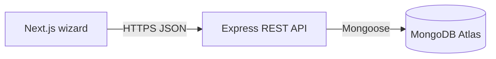

# GoPratle Requirement Posting

A full-stack event requirement posting application with a four-step, category-aware wizard, a REST API, and MongoDB persistence.

See [PROJECT_OWNER_GUIDE.md](PROJECT_OWNER_GUIDE.md) for the architecture, local setup, API behavior, tests, deployment guidance, and owner responsibilities.

**Live frontend:** not deployed yet  
**GitHub repository:** add repository URL after publishing

## Features

- Event basics, category requirements, optional context, and review steps.
- Category-specific validation and fields for planners, performers, and crew.
- Express API with Zod validation, rate limiting, Helmet, restricted CORS, and safe errors.
- MongoDB persistence via Mongoose, category filtering and paginated listing.
- Real API-backed success state with the created requirement ID.
- Backend unit/API tests and frontend component tests.

## Technology stack

- **Frontend:** Next.js App Router, React, TypeScript, Tailwind CSS, React Hook Form, Zod, and Lucide React.
- **Backend:** Node.js, Express, TypeScript, Mongoose, MongoDB, and Zod.
- **Tests and quality:** Vitest, Supertest, Testing Library, ESLint, and TypeScript checks.

## Repository layout

```text
frontend/src/app/             Next.js page and global styles
frontend/src/components/      Wizard and reusable form controls
frontend/src/lib/             API client
frontend/src/schemas/         Frontend validation
frontend/src/types/           Requirement payload types
backend/src/config/           Database setup
backend/src/controllers/      HTTP request handlers
backend/src/middleware/       Safe errors and not-found handling
backend/src/models/           Mongoose Requirement model
backend/src/routes/           REST routes and write rate limiting
backend/src/services/         Persistence and listing logic
backend/src/validators/       Authoritative request schemas
backend/tests/                API tests using an isolated in-memory MongoDB
```

## Architecture



The backend is authoritative for validation. Details are stored as a category-specific object, and `category` is normalized to `planner`, `performer`, or `crew`.

## Requirements and local setup

- Node.js 20.9 or later and npm.
- Docker Desktop with Compose (for the included local MongoDB service), or MongoDB Atlas.

Install both applications:

```bash
cd backend && npm install
cd ../frontend && npm install
```

Start the local MongoDB container from the repository root:

```bash
docker compose up -d mongodb
docker compose ps
```

The container stores its data in the persistent `gopratle-mongo-data` Docker volume and listens only on `127.0.0.1:27017`. The backend's example `MONGODB_URI` is already set for this local database. Stop it with `docker compose down`; this keeps the data volume.

Copy each `.env.example` to `.env` and set values. Start the backend and frontend in separate terminals:

```bash
cd backend && npm run dev
cd frontend && npm run dev
```

Open http://localhost:3000. The API listens on port 4000 by default.

### Environment variables

| Application | Variable | Description |
|---|---|---|
| Backend | `PORT` | HTTP port (default `4000`) |
| Backend | `MONGODB_URI` | MongoDB connection string (required to start) |
| Backend | `CLIENT_URL` | Allowed frontend origin, e.g. `http://localhost:3000` |
| Backend | `NODE_ENV` | `development`, `test`, or `production` |
| Frontend | `NEXT_PUBLIC_API_URL` | Backend origin, e.g. `http://localhost:4000` |

## Scripts

Run from each application directory:

```bash
npm run dev       # local development
npm run build     # production build
npm run lint      # ESLint
npm test          # automated tests
npm run typecheck # TypeScript checks
```

Backend tests use an in-memory MongoDB server and never use `MONGODB_URI`.

## API

All responses use JSON. Health: `GET /api/health`.

Create: `POST /api/requirements` (201). Example planner payload:

```json
{
  "eventName": "Summer celebration",
  "eventType": "Private Party",
  "startDate": "2027-06-12",
  "endDate": "2027-06-12",
  "location": "Pune, India",
  "venue": "Garden Hall",
  "category": "planner",
  "details": {
    "services": ["event planning", "catering"],
    "guestCount": 120,
    "budgetMin": 50000,
    "budgetMax": 100000,
    "planningScope": "full-service",
    "additionalRequirements": "Outdoor setup"
  },
  "additionalDetails": {
    "description": "An evening celebration",
    "contactMethod": "email"
  }
}
```

Success response:

```json
{
  "success": true,
  "message": "Requirement created successfully",
  "data": {
    "id": "MongoDB ObjectId",
    "category": "planner",
    "status": "submitted",
    "createdAt": "ISO-8601 timestamp"
  }
}
```

- `GET /api/requirements/:id` fetches one requirement.
- `GET /api/requirements?category=planner&page=1&limit=10` lists paginated records. Public list responses omit contact preferences and special instructions; this demo has no authentication, so deploy it only with suitable access controls if requirements contain sensitive information.

The list response shape is `{ "success": true, "data": { "items": [], "pagination": { "page": 1, "limit": 10, "total": 0, "pages": 0 } } }`. Health returns `{ "success": true, "data": { "status": "ok" } }`.

## Data model

Each `Requirement` has event fields (`eventName`, `eventType`, dates, `location`, and optional `venue`), one normalized `category`, validated category-specific `details`, optional `additionalDetails`, and a fixed `submitted` status. Mongoose timestamps maintain `createdAt` and `updatedAt`; indexes support newest-first sorting and category filtering. The list API removes contact preference and special instructions from results.

## Deployment

1. **MongoDB Atlas:** create a database user and database, restrict network access to the backend service as practical, then copy the connection URI into Render. Never commit credentials.
2. **Render:** create a Node web service with root `backend`, build `npm install && npm run build`, and start `npm start`. Set `NODE_ENV=production`, `MONGODB_URI`, and `CLIENT_URL` to the deployed frontend origin. Render sets `PORT`; the server binds to `0.0.0.0` and waits for MongoDB before listening. Health check path: `/api/health`. The local Docker database is for development only; use Atlas for the deployed backend.
3. **Vercel:** import the repository, set root directory `frontend`, and configure `NEXT_PUBLIC_API_URL` to the HTTPS Render service URL. Set the matching Vercel origin in Render's `CLIENT_URL`.
4. Test `/api/health` and submit a requirement from the deployed UI. Free Render instances may sleep and have a cold start on the first request.

No services are deployed or database connection verified by this repository setup.

## Limitations and next steps

- This assignment demo has no authentication or vendor access controls. Add authorization and privacy rules before using real customer requirements in production.
- The demo stores a preferred contact method but does not collect an email address or phone number.
- A production deployment should add request tracing, alerting, backups, and an explicit data retention policy.
- Render free services may sleep between requests, which can make the first API request take longer.
- Production dependency audits report no vulnerabilities. The full development dependency audit still reports advisories in the test and styling toolchain; refresh those packages before running the toolchain on untrusted code.
